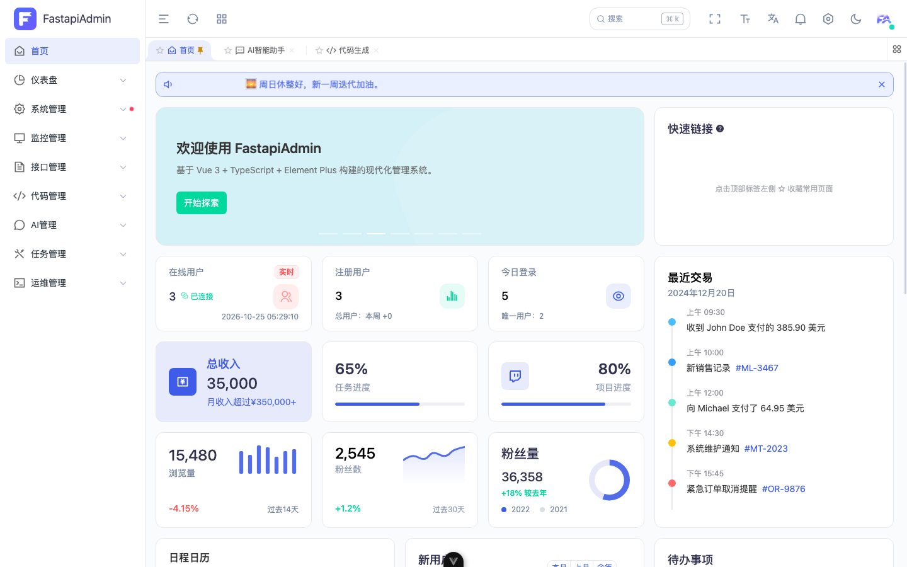

<div align="center">
     <p align="center">
          
     </p>
     <h1>FastTrade</h1>
     <h3>📈 An open-source quantitative trading workbench from data to live execution</h3>
     <p>Write one strategy, run it through <b>data → backtest → paper → live</b>, across <b>Web3, A-shares and futures</b>.</p>
     <p align="center">
          
          
          
          
          <a href="./LICENSE"></a>
     </p>

English | [简体中文](./README.md)

</div>

## 📌 What is FastTrade

FastTrade is a decoupled quantitative trading platform. The backend is built on **FastAPI + SQLAlchemy 2 (async) + APScheduler + Redis**; the frontend uses **Vue 3 + TypeScript + Vite + Element Plus**.

It turns the common quant workflow into one continuous pipeline:

```text
Market data  →  Strategy  →  Backtest  →  Paper trading  →  Live trading
(Binance/CSV)  (auto-discovery)  (local engine)  (real-time feed)  (Binance/broker)
```

The core design is **write the strategy once**: the same code runs in backtest, paper and live modes, with only the executor swapped. All three markets share one strategy directory and one trading API; only data sources, tables and brokers differ. The admin console (users, roles, menus, logs, tasks, storage, etc.) is the platform foundation, not the focus of this project.

> Full manual: [`docs/README.md`](./docs/README.md).

## 🎯 Quant capabilities

| Capability | Description |
| --- | --- |
| 🪙 **Binance data download** | Official REST, public mirror and historical archive ZIP; spot and USD-M futures; long histories fetched by month/day archives with dedupe, merge and recent-fill |
| 📥 **Local CSV import** | Standard OHLCV (`date,open,high,low,close,volume`) with path restrictions; imported files become reusable datasets |
| 📊 **Data charts** | ECharts candlesticks + volume + OHLCV table; 2000 most recent candles by default to keep payloads small |
| 🧠 **Strategy auto-discovery** | Scans `user_data/strategies/*.py` and detects event or signal mode automatically |
| ⚡ **Event-driven backtest** | Signal at current close, fill at next open; returns return, annualized return, max drawdown, win rate, trades and equity curve |
| 📝 **Paper trading** | Real-time feed + virtual cash, immediate local matching, persisted ledger |
| 🔴 **Live trading** | Reuses the same strategy; `dry_run` by default, Fernet-encrypted keys, plaintext never returned by any API |
| 🖥️ **CLI + REST + UI** | Download, import, backtest, start/stop and manual ticks via CLI, API or web pages |
| 🏦 **Three markets** | Web3 / A-shares / futures share the strategy and execution engine; pluggable brokers (XTP / CTP simulated by default) |

### The three markets

| Market | Route prefix | Data directory | Table prefix | Feed / broker |
| --- | --- | --- | --- | --- |
| **web3-quant** | `/quant` | `user_data/data/binance` | `quant_web3_*` | Binance REST / mirror / archive |
| **A-shares** | `/quant-astock` | `user_data/data/astock` | `quant_astock_*` | Local CSV / XTP (simulated) |
| **Futures** | `/quant-futures` | `user_data/data/futures` | `quant_futures_*` | Local CSV / CTP (simulated) |

> Each market has data, chart, backtest, paper and live pages. A-shares / futures currently use simulated broker adapters; wiring in a real SDK requires no changes to strategies or pages.

## 🔁 One strategy, three modes

```text
                    One strategy file (user_data/strategies/*.py)
                                  │
                    api.buy / sell / sellshort / buycover / close_all
                                  │
              ┌───────────────────┼───────────────────┐
              ▼                   ▼                   ▼
        Backtest executor    Paper executor      Live executor
        next-open fill       last-price fill     Binance order + ledger
```

| Step | Backtest | Paper | Live |
| --- | --- | --- | --- |
| Feed | Local CSV | Rolling real-time candles | Rolling real-time candles |
| Fill | Next candle open | Last price, immediate | Last price + Binance order |
| Capital | Initial cash | Virtual cash | Real / simulated (`dry_run`) |
| Shorting | Supported | Supported | Not supported for spot live orders |
| Driver | One-shot run | Continuous polling | Continuous polling |

### Strategy example

```python
from quant_api import Strategy


class SmaCrossStrategy(Strategy):
    """5/20 SMA cross: long on golden cross, exit on death cross."""

    name = "SMA cross"
    timeframe = "1h"
    startup_candle_count = 20

    def on_bar(self, api, candles, index):
        fast = api.sma(5)
        slow = api.sma(20)
        if index < self.startup_candle_count:
            return
        if fast[index - 1] <= slow[index - 1] and fast[index] > slow[index]:
            api.buy(ratio=0.95, reason="golden_cross")
        elif fast[index - 1] >= slow[index - 1] and fast[index] < slow[index]:
            api.sell(reason="death_cross")
```

A signal-mode strategy can instead implement `populate_entry_trend()` / `populate_exit_trend()` (freqtrade-style signal columns). Available APIs include `buy`, `sell`, `sellshort`, `buycover`, `close_all`, `sma`, `ema`, `rsi`, `log`, plus `cash` / `equity` / `position` state.

## 🚀 Quick start

### Requirements

| Dependency | Version |
| --- | --- |
| Python | ≥ 3.12 (`uv` recommended) |
| Node.js | ≥ 20.19 (pnpm 9 recommended) |
| PostgreSQL | 14+ (default database) |
| Redis | 7.x (sessions / cache / rate limit) |

### Start the backend

```bash
cp backend/env/.env.example backend/env/.env.dev   # set DATABASE_* / REDIS_* / SECRET_KEY
cd backend
uv sync
uv run main.py run --env=dev
```

The first launch applies migrations, creates tables and loads seed data. API docs: <http://127.0.0.1:8001/docs>.

### Start the frontend

```bash
cd front-web
pnpm install
pnpm dev
```

Open <http://127.0.0.1:5180> and log in with the seed account `admin / 123456` (other seed users: `super`, `user`; change passwords after first login). If the quant menus are missing, run the idempotent menu seeding command once:

```bash
cd backend && uv run python main.py quant init-menu --env=dev
```

Then log in again to refresh the menu.

## 🧭 Quant workflow

### 1. Prepare data

- **Binance**: go to **Quant → Download**, choose symbol, interval, spot/futures, time range and source (`api` / `mirror` / `archive`).
- **Local CSV**: use the `date,open,high,low,close,volume` header, place files under `user_data/data/` and import them.
- **A-shares / futures**: import CSV on the market's **Data** page; ticks prefer the imported dataset for the same symbol.

### 2. Develop a strategy

Put the strategy file under `user_data/strategies/`; it appears automatically in the strategy selector. No backend restart is required after edits.

### 3. Backtest

Select a dataset and strategy, set initial cash, fee rate and slippage, then run. Results include:

- final equity, total return, annualized return, max drawdown, win rate;
- every trade (side, quantity, price, fee, PnL, reason);
- equity curve and strategy logs.

### 4. Paper / live trading

Create an instance on the **Paper** or **Live** page, then start continuous polling, run a manual tick, or inspect the account and trade history.

> **Safe defaults**: `dry_run=True` means no exchange connection and no real orders. Real orders require explicitly disabling dry-run and configuring Binance API Key / Secret. Grant spot-trading permission only and **never enable withdrawals**. Spot live trading does not support shorting.

## 💻 CLI cheat sheet

Run all commands from `backend/`. `quant` is the primary command; `mingling` is an alias.

```bash
# List auto-discovered strategies
uv run python main.py quant strategies --env=dev

# Download Binance data: official REST / public mirror / historical archive
uv run python main.py quant download -s BTC/USDT -i 1h --days 30 --env=dev
uv run python main.py quant download -s BTC/USDT -i 4h --market futures --source archive \
  --start 2024-01-01 --end 2024-12-31 --env=dev

# Import a local CSV
uv run python main.py quant import user_data/data/my_data.csv \
  --symbol BTC/USDT --interval 1h --env=dev

# Run a backtest
uv run python main.py quant backtest --dataset 1 --strategy SmaCrossStrategy \
  --cash 10000 --fee 0.001 --slippage 0.0005 --env=dev

# Create a paper / live instance and drive it
uv run python main.py quant live-create --name BTC-1h-SMA \
  --strategy SmaCrossStrategy --symbol BTC/USDT --interval 1h \
  --mode paper --cash 10000 --env=dev
uv run python main.py quant live-tick 1 --env=dev
uv run python main.py quant live-tick 1 \
  --data-file user_data/data/binance/BTCUSDT_1h.csv --env=dev
```

`--data-file` runs one tick offline from a local CSV, useful for restricted networks or regression checks.

## 🔌 API and permissions

Quant endpoints live under `/api/v1` and use the project's unified response envelope:

| Prefix | Description |
| --- | --- |
| `/api/v1/quant/data` | Datasets, download, import, candles |
| `/api/v1/quant/strategies` | Strategy list |
| `/api/v1/quant/backtest` | Backtest runs and records |
| `/api/v1/quant/live` | Live instances, start/stop, tick, trade history |
| `/api/v1/quant-astock` | A-share data / backtest / live |
| `/api/v1/quant-futures` | Futures data / backtest / live |

Permission prefixes match the routes: `module_quant:*`, `module_quant_astock:*`, `module_quant_futures:*`, with actions such as `data:query/download/import`, `strategy:query`, `backtest:run/query`, and `live:create/query/update/start/run/delete`. Superusers are allowed by default; grant permissions to normal roles under **System → Roles**.

## 📦 Project structure

```text
FastTrade/
├─ backend/                       # FastAPI backend
│  ├─ app/modules/quant/          # web3 quant: data, strategy, backtest, execution, runtime
│  ├─ app/modules/quant_market/   # Shared A-share + futures module (parametrized by market key)
│  ├─ app/modules/system/         # Users, roles, menus, depts, dicts, logs (platform base)
│  ├─ app/modules/task/           # Scheduled jobs and storage workflows
│  ├─ app/modules/monitor/        # Server / cache / online-user monitoring
│  ├─ app/modules/ai/             # AI chat
│  ├─ app/modules/generator/      # Code generator
│  ├─ app/modules/ops/            # SSH terminal, DB console
│  ├─ app/api/v1/routers.py       # Single route registration entry
│  └─ app/alembic/versions/       # Database migrations
├─ front-web/                     # Vue 3 admin console
│  └─ src/views/
│     ├─ module_quant/            # web3 pages (download, chart, backtest, paper, live)
│     ├─ module_quant_astock/     # A-share pages
│     ├─ module_quant_futures/    # Futures pages
│     └─ module_quant_market/     # Shared A-share / futures workspace components
├─ user_data/
│  ├─ data/                       # Market CSV files (binance / astock / futures)
│  └─ strategies/                 # Shared strategy directory for all markets
├─ docs/quant/                    # Quant operations and development docs
└─ AGENTS.md                      # AI agent and collaboration conventions
```

There are 12 quant tables (4 per market): `*_dataset`, `*_backtest`, `*_live_strategy`, `*_trade_record`.

## 🛠️ Tech stack

| Layer | Technology |
| --- | --- |
| Backend | Python 3.12+ · FastAPI · Pydantic v2 · SQLAlchemy 2 (async) · Alembic |
| Storage | PostgreSQL · Redis · SQLite (tests) |
| Frontend | Vue 3 · TypeScript · Vite · Element Plus · Pinia · Tailwind CSS 4 · ECharts |
| Scheduling | APScheduler · asyncio polling |
| Integrations | Binance REST / archive · XTP / CTP adapters · SFTP / S3 / OSS / COS / OBS |
| Testing | pytest (backend) · Vitest (frontend) |

## 🧱 Platform foundation (secondary)

The admin console provides general capabilities beyond quant. They work out of the box but are not the focus of this project:

| Module | Capabilities |
| --- | --- |
| System | Users, roles, menus, departments, positions, dicts, params, notices, tickets, versions |
| Monitoring | Online users, server, cache, health checks |
| Logs | Operation audit |
| Tasks | Scheduled jobs, visual storage workflows |
| Storage | Local / SFTP / S3 / OSS / COS / OBS |
| Dev tools | Code generator, SSH terminal, DB console, API docs |

## 🖥️ Screenshot

The admin console uses the FastTrade brand theme. Quant pages live under **Quant / Quant-A-shares / Quant-Futures** in the sidebar:



## 🧪 Testing

```bash
# Backend (sqlite + mocked Redis by default, no external services)
cd backend
uv run pytest -q
uv run pytest tests/test_quant_engine.py -q

# Frontend
cd front-web
pnpm test
pnpm type-check
```

Integration tests that need real PostgreSQL / Redis are skipped by default; enable them with `TEST_DB_TYPE=postgres RUN_INTEGRATION=1`.

## 📚 Documentation

- Quant overview: [`docs/README.md`](./docs/README.md)
- [Data download and import](./docs/quant/01-数据下载与导入.md)
- [Strategy development](./docs/quant/02-策略开发.md)
- [Backtesting](./docs/quant/03-回测操作.md)
- [CLI](./docs/quant/04-命令行.md)
- [API reference](./docs/quant/05-API参考.md)
- [Paper and live trading](./docs/quant/06-模拟盘与实盘.md)
- [Unified strategy API](./docs/quant/07-统一策略接口.md)
- [Three markets and charts](./docs/quant/08-三市场与数据图表.md)

## ⚠️ Risks and boundaries

- This project is for research and learning and **does not constitute investment advice**; live PnL is your own responsibility.
- Backtests suffer from overfitting, slippage and liquidity biases; past performance does not guarantee future returns.
- Live trading defaults to `dry_run`; validate thoroughly with paper trading and small capital first.
- Binance spot live trading does not support shorting. Futures details such as funding rates, margin, partial fills and order-book depth are not implemented.
- A-share / futures XTP / CTP adapters are currently simulated and not connected to real SDKs.
- Keep secrets in `backend/env/.env.*` or encrypted fields; **never commit them**.

## 🤝 Contributing

Issues and PRs are welcome. Read [`AGENTS.md`](./AGENTS.md) first and make sure `uv run ruff check`, relevant `pytest` suites, `pnpm type-check` and `pnpm test` pass before submitting.

## 🙏 Acknowledgments

- Quant concepts inspired by [freqtrade](https://www.freqtrade.io/) for data archives and signal columns;
- Admin foundation derived from [FastapiAdmin](https://gitee.com/fastapiadmin/FastapiAdmin);
- Backend: [FastAPI](https://fastapi.tiangolo.com/) · [Pydantic](https://docs.pydantic.dev/) · [SQLAlchemy](https://www.sqlalchemy.org/) · [APScheduler](https://github.com/agronholm/apscheduler)
- Frontend: [Vue 3](https://vuejs.org/) · [TypeScript](https://www.typescriptlang.org/) · [Vite](https://vite.dev/) · [Element Plus](https://element-plus.org/) · [ECharts](https://echarts.apache.org/)

## 📄 License

[MIT](./LICENSE)
