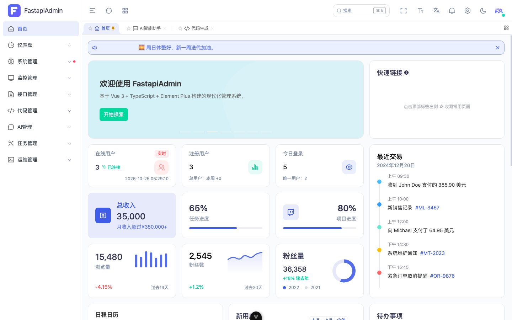

<div align="center">
     <p align="center">
          
     </p>
     <h1>FastTrade</h1>
     <h3>📈 从数据到实盘的开源量化交易工作台</h3>
     <p>一套策略代码，贯通 <b>数据下载 / 回测 / 模拟盘 / 实盘</b>，同时覆盖 <b>Web3、A 股、期货</b> 三个市场。</p>
     <p align="center">
          
          
          
          
          <a href="./LICENSE"></a>
     </p>

简体中文 | [English](./README.en.md)

</div>

## 📌 FastTrade 是什么

FastTrade 是一个前后端分离的量化交易平台：后端基于 **FastAPI + SQLAlchemy 2（异步）+ APScheduler + Redis**，前端基于 **Vue 3 + TypeScript + Vite + Element Plus**。

它把量化研究中最常用的四件事做成了一条完整链路：

```text
行情数据  →  策略开发  →  回测验证  →  模拟盘跟踪  →  实盘执行
（币安/CSV）  （自动发现）  （本地引擎）  （实时行情）  （币安/柜台）
```

核心设计是 **策略只写一次**：同一份策略同时用于回测、模拟盘和实盘，只切换执行器；三个市场共用同一套策略目录与交易接口，只是数据源、数据表和柜台不同。管理台（用户、角色、菜单、日志、任务、存储等）作为平台底座提供，不是本项目的重点。

> 完整操作手册见 [`docs/quant/README.md`](./docs/quant/README.md)；管理后台操作文档见 [`docs/admin/README.md`](./docs/admin/README.md)。

## 🎯 量化核心能力

| 能力 | 说明 |
| --- | --- |
| 🪙 **币安数据下载** | 官方 REST、公开镜像、历史归档 ZIP 三种来源；支持现货与 U 本位合约，长历史按整月/整日归档拉取，自动去重合并、补齐近端 |
| 📥 **本地 CSV 导入** | 标准 OHLCV（`date,open,high,low,close,volume`），路径限制在允许目录内，导入后登记为可复用数据集 |
| 📊 **数据图表** | ECharts 绘制 K 线 + 成交量 + OHLCV 明细表，默认返回最近 2000 根，避免大文件拖垮前端 |
| 🧠 **策略自动发现** | 扫描 `user_data/strategies/*.py`，自动识别事件模式与信号模式 |
| ⚡ **事件驱动回测** | 当前 K 线收盘产生信号、下一根开盘成交；输出收益、年化、最大回撤、胜率、成交流水与净值曲线 |
| 📝 **模拟盘（paper）** | 实时行情 + 虚拟资金，本地即时撮合，账本持久化 |
| 🔴 **实盘（live）** | 复用同一策略；默认 `dry_run` 不下真实单，密钥 Fernet 加密落库且接口永不回传明文 |
| 🖥️ **CLI + REST + 页面** | 下载、导入、回测、实例启停、手动 tick 均可用命令行、API 或页面完成 |
| 🏦 **三市场统一** | Web3 / A 股 / 期货页面结构一致，共用策略与执行引擎，柜台可插拔（XTP / CTP 默认模拟） |

### 三个市场

| 市场 | 路由前缀 | 数据目录 | 数据表前缀 | 行情 / 柜台 |
| --- | --- | --- | --- | --- |
| **web3-量化** | `/quant` | `user_data/data/binance` | `quant_web3_*` | 币安 REST / 镜像 / 历史归档 |
| **量化-A股** | `/quant-astock` | `user_data/data/astock` | `quant_astock_*` | 本地 CSV / XTP（默认模拟） |
| **量化-期货** | `/quant-futures` | `user_data/data/futures` | `quant_futures_*` | 本地 CSV / CTP（默认模拟） |

> 三个市场各有「数据、数据图表、回测、模拟盘、实盘」页面；A 股 / 期货当前柜台为模拟适配层，接入真实 SDK 时上层策略与页面无需改动。

## 🔁 一套策略，三种模式

```text
                    同一份策略代码（user_data/strategies/*.py）
                                  │
                    api.buy / sell / sellshort / buycover / close_all
                                  │
              ┌───────────────────┼───────────────────┐
              ▼                   ▼                   ▼
          回测执行器           模拟盘执行器          实盘执行器
       下一根开盘价撮合       最新价虚拟撮合       币安下单 + 记账
```

| 环节 | 回测 | 模拟盘 paper | 实盘 live |
| --- | --- | --- | --- |
| 行情 | 本地 CSV | 实时滚动 K 线 | 实时滚动 K 线 |
| 撮合 | 下一根开盘价 | 最新价即时撮合 | 最新价即时撮合 + 币安下单 |
| 资金 | 初始资金 | 虚拟资金 | 真实 / 模拟（看 `dry_run`） |
| 做空 | 支持 | 支持 | 币安现货真实下单不支持 |
| 驱动 | 一次性跑完 | 常驻轮询 | 常驻轮询 |

### 策略示例

```python
from quant_api import Strategy


class SmaCrossStrategy(Strategy):
    """5/20 均线交叉：金叉开多，死叉平多。"""

    name = "SMA均线交叉"
    timeframe = "1h"
    startup_candle_count = 20

    def on_bar(self, api, candles, index):
        fast = api.sma(5)
        slow = api.sma(20)
        if index < self.startup_candle_count:
            return
        if fast[index - 1] <= slow[index - 1] and fast[index] > slow[index]:
            api.buy(ratio=0.95, reason="golden_cross")
        elif fast[index - 1] >= slow[index - 1] and fast[index] < slow[index]:
            api.sell(reason="death_cross")
```

策略还可以用信号模式实现 `populate_entry_trend()` / `populate_exit_trend()`（参考 freqtrade 的信号列写法）。可用接口包括 `buy`、`sell`、`sellshort`、`buycover`、`close_all`、`sma`、`ema`、`rsi`、`log` 以及 `cash` / `equity` / `position` 等状态属性。

## 🚀 快速开始

### 环境要求

| 依赖 | 版本 |
| --- | --- |
| Python | ≥ 3.12（推荐 `uv` 管理依赖） |
| Node.js | ≥ 20.19（推荐 pnpm 9） |
| PostgreSQL | 14+（默认数据库） |
| Redis | 7.x（会话 / 缓存 / 限流） |

### 启动后端

```bash
cp backend/env/.env.example backend/env/.env.dev   # 填写 DATABASE_* / REDIS_* / SECRET_KEY
cd backend
uv sync
uv run main.py run --env=dev
```

首次启动会自动执行迁移、建表并写入基础数据。接口文档：<http://127.0.0.1:8001/docs>。

### 启动前端

```bash
cd front-web
pnpm install
pnpm dev
```

浏览器打开 <http://127.0.0.1:5180>，使用种子账号 `admin / 123456` 登录（其他种子账号：`super`、`user`，首次登录后请修改密码）。若侧栏没有量化菜单，执行一次幂等补菜单命令：

```bash
cd backend && uv run python main.py quant init-menu --env=dev
```

然后重新登录刷新菜单。

## 🧭 量化操作流程

### 1. 准备数据

- **币安数据**：进入「量化 → 下载」，选择交易对、周期、现货/合约、时间范围与来源（`api` / `mirror` / `archive`）。
- **本地 CSV**：按 `date,open,high,low,close,volume` 表头准备文件，放到 `user_data/data/` 下后导入。
- **A 股 / 期货**：在对应市场的「数据」页导入 CSV 即可，tick 时会优先使用同代码已导入的数据集。

### 2. 开发策略

把策略文件放入 `user_data/strategies/`，在页面选择策略时即可看到自动发现结果。修改后无需重启后端。

### 3. 回测验证

在「回测」页选择数据集与策略，设置初始资金、手续费率、滑点后执行。结果包含：

- 期末净值、总收益率、年化收益率、最大回撤、胜率；
- 每笔成交（方向、数量、价格、手续费、盈亏、原因）；
- 净值曲线与策略日志。

### 4. 模拟盘 / 实盘

在「模拟盘」或「实盘」页创建实例，可启动常驻轮询、手动运行一次 tick、查看账户与成交流水。

> **实盘安全默认值**：`dry_run=True`，不连接交易所、不下真实单。只有显式关闭 dry-run 且配置币安 API Key / Secret 后才会真实下单。Key 建议只授予现货交易权限，**不要开启提现**；现货真实模式不支持做空。

## 💻 命令行速查

所有命令在 `backend/` 目录执行，`quant` 为主命令，`mingling` 为兼容别名。

```bash
# 列出自动发现的策略
uv run python main.py quant strategies --env=dev

# 下载币安数据：官方 REST / 公开镜像 / 历史归档
uv run python main.py quant download -s BTC/USDT -i 1h --days 30 --env=dev
uv run python main.py quant download -s BTC/USDT -i 4h --market futures --source archive \
  --start 2024-01-01 --end 2024-12-31 --env=dev

# 导入本地 CSV
uv run python main.py quant import user_data/data/my_data.csv \
  --symbol BTC/USDT --interval 1h --env=dev

# 执行回测
uv run python main.py quant backtest --dataset 1 --strategy SmaCrossStrategy \
  --cash 10000 --fee 0.001 --slippage 0.0005 --env=dev

# 创建模拟盘 / 实盘实例并驱动
uv run python main.py quant live-create --name BTC-1h-SMA \
  --strategy SmaCrossStrategy --symbol BTC/USDT --interval 1h \
  --mode paper --cash 10000 --env=dev
uv run python main.py quant live-tick 1 --env=dev
uv run python main.py quant live-tick 1 \
  --data-file user_data/data/binance/BTCUSDT_1h.csv --env=dev
```

`--data-file` 支持离线用本地 CSV 驱动一次 tick，适合网络受限或回归验证。

## 🔌 API 与权限

量化接口统一挂在 `/api/v1` 下，使用项目统一响应信封：

| 前缀 | 说明 |
| --- | --- |
| `/api/v1/quant/data` | 数据集、下载、导入、K 线 |
| `/api/v1/quant/strategies` | 策略列表 |
| `/api/v1/quant/backtest` | 回测执行与记录 |
| `/api/v1/quant/live` | 实时策略实例、启停、tick、成交流水 |
| `/api/v1/quant-astock` | A 股数据 / 回测 / 实时策略 |
| `/api/v1/quant-futures` | 期货数据 / 回测 / 实时策略 |

权限码与路由前缀对应：`module_quant:*`、`module_quant_astock:*`、`module_quant_futures:*`，动作包括 `data:query/download/import`、`strategy:query`、`backtest:run/query`、`live:create/query/update/start/run/delete`。超级管理员默认放行，普通角色需在「系统管理 → 角色管理」授权。

## 📦 工程结构

```text
FastTrade/
├─ backend/                       # FastAPI 后端
│  ├─ app/modules/quant/          # web3 量化：数据、策略、回测、执行、实时实例
│  ├─ app/modules/quant_market/   # A股 + 期货通用模块（按 market key 参数化）
│  ├─ app/modules/system/         # 用户、角色、菜单、部门、字典、日志等平台底座
│  ├─ app/modules/task/           # 定时任务与存储工作流
│  ├─ app/modules/monitor/        # 服务 / 缓存 / 在线用户监控
│  ├─ app/modules/ai/             # AI 对话
│  ├─ app/modules/generator/      # 代码生成器
│  ├─ app/modules/ops/            # SSH 终端、数据库控制台
│  ├─ app/api/v1/routers.py       # 唯一路由注册入口
│  └─ app/alembic/versions/       # 数据库迁移
├─ front-web/                     # Vue 3 管理台
│  └─ src/views/
│     ├─ module_quant/            # web3 页面（下载、图表、回测、模拟盘、实盘）
│     ├─ module_quant_astock/     # A 股页面
│     ├─ module_quant_futures/    # 期货页面
│     └─ module_quant_market/     # A 股 / 期货共享工作区组件
├─ user_data/
│  ├─ data/                       # 行情 CSV（binance / astock / futures）
│  └─ strategies/                 # 三市场共用策略目录
├─ docs/admin/                    # 管理后台操作与开发文档
├─ docs/quant/                    # 量化操作与开发文档
└─ AGENTS.md                      # AI Agent 与协作规范
```

量化相关表共 12 张（每个市场 4 张）：`*_dataset`、`*_backtest`、`*_live_strategy`、`*_trade_record`。

## 🛠️ 技术栈

| 层 | 技术 |
| --- | --- |
| 后端 | Python 3.12+ · FastAPI · Pydantic v2 · SQLAlchemy 2（异步）· Alembic |
| 存储 | PostgreSQL · Redis · SQLite（测试） |
| 前端 | Vue 3 · TypeScript · Vite · Element Plus · Pinia · Tailwind CSS 4 · ECharts |
| 调度 / 任务 | APScheduler · asyncio 常驻轮询 |
| 外部集成 | 币安 REST / 历史归档 · XTP / CTP 适配层 · SFTP / S3 / OSS / COS / OBS |
| 测试 | pytest（后端）· Vitest（前端） |

## 🧱 平台底座（次要）

管理台提供量化之外的通用能力，开箱即用但不属于本项目重点：

| 模块 | 能力 |
| --- | --- |
| 系统管理 | 用户、角色、菜单、部门、岗位、字典、参数、公告、工单、版本 |
| 监控 | 在线用户、服务器、缓存、健康检查 |
| 日志 | 操作日志审计 |
| 任务 | 定时任务、可视化存储工作流 |
| 存储 | 本地 / SFTP / S3 / OSS / COS / OBS |
| 开发工具 | 代码生成器、SSH 终端、数据库控制台、接口文档 |

## 🖥️ 界面

管理台基于 FastTrade 品牌主题，量化页面位于侧栏「量化 / 量化-A股 / 量化-期货」目录：



## 🧪 测试

```bash
# 后端（默认 sqlite + mock Redis，无需外部服务）
cd backend
uv run pytest -q
uv run pytest tests/test_quant_engine.py -q

# 前端
cd front-web
pnpm test
pnpm type-check
```

需要真实 PostgreSQL / Redis 的集成用例默认跳过，使用 `TEST_DB_TYPE=postgres RUN_INTEGRATION=1` 显式开启。

## 📚 文档

- 管理后台总览与目录：[`docs/admin/README.md`](./docs/admin/README.md)
- [登录与个性化](./docs/admin/01-登录与个性化.md)
- [系统管理](./docs/admin/02-系统管理.md)
- [日志与监控](./docs/admin/03-日志与监控.md)
- [定时任务与存储](./docs/admin/04-定时任务与存储.md)
- [运维与开发](./docs/admin/05-运维与开发.md)
- [AI助手](./docs/admin/06-AI助手.md)
- [权限与安全](./docs/admin/07-权限与安全.md)
- 量化总览与目录：[`docs/quant/README.md`](./docs/quant/README.md)
- [数据下载与导入](./docs/quant/01-数据下载与导入.md)
- [策略开发](./docs/quant/02-策略开发.md)
- [回测操作](./docs/quant/03-回测操作.md)
- [命令行](./docs/quant/04-命令行.md)
- [API 参考](./docs/quant/05-API参考.md)
- [模拟盘与实盘](./docs/quant/06-模拟盘与实盘.md)
- [统一策略接口](./docs/quant/07-统一策略接口.md)
- [三市场与数据图表](./docs/quant/08-三市场与数据图表.md)

## ⚠️ 风险与边界

- 本项目仅供研究与技术学习，**不构成投资建议**；实盘盈亏由使用者自行承担。
- 回测存在过拟合、滑点、流动性等现实偏差，历史表现不代表未来收益。
- 实盘默认 `dry_run`；真实下单前请用小额资金与模拟盘充分验证。
- 币安现货真实模式不支持做空；期货细节（资金费率、保证金、部分成交、订单簿深度）尚未实现。
- A 股 / 期货的 XTP / CTP 当前为模拟柜台，未接入真实 SDK。
- 密钥请放在 `backend/env/.env.*` 或加密字段中，**不要提交到仓库**。

## 🤝 参与贡献

欢迎提交 Issue / PR。提交前请阅读 [`AGENTS.md`](./AGENTS.md)，并确保后端 `uv run ruff check`、相关 `pytest` 与前端 `pnpm type-check`、`pnpm test` 通过。

## 🙏 鸣谢

- 量化思路参考 [freqtrade](https://www.freqtrade.io/) 的数据归档与信号列设计；
- 管理台底座源自 [FastapiAdmin](https://gitee.com/fastapiadmin/FastapiAdmin)；
- 后端：[FastAPI](https://fastapi.tiangolo.com/) · [Pydantic](https://docs.pydantic.dev/) · [SQLAlchemy](https://www.sqlalchemy.org/) · [APScheduler](https://github.com/agronholm/apscheduler)
- 前端：[Vue 3](https://cn.vuejs.org/) · [TypeScript](https://www.typescriptlang.org/) · [Vite](https://vitejs.dev/) · [Element Plus](https://element-plus.org/) · [ECharts](https://echarts.apache.org/)

## 📄 License

[MIT](./LICENSE)
